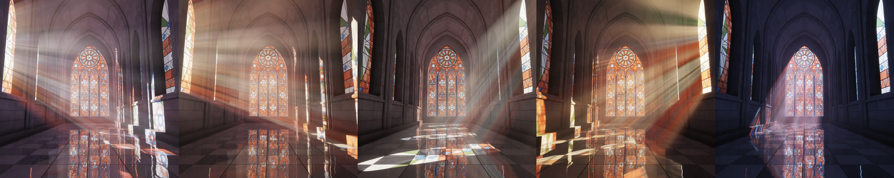

# Vitrail

A Gothic nave lit only by its stained-glass windows. Shafts of coloured light cross the haze, land on the stone and pool on a polished floor. Everything runs in real time in the browser.

**[Open it →](https://solariacosmo.github.io/vitrail/)**

## The hours

The light follows your local clock by default (**Now**). It blends between five canonical hours as the day goes on. You can also pick one:

| Hour | Time | Light |
|---|---|---|
| **Matins** | pre-dawn | cool lavender light, low from the left |
| **Lauds** | sunrise | warm, low sun through the left-hand windows |
| **Sext** | noon | high sun; patches of colour fall in the middle of the floor |
| **Vespers** | sunset | amber light raking in from the right |
| **Compline** | night | moonlight through the great west window |

**Terracotta glass** swaps every window to a warm clay-orange palette with ivory, oat and sand panes.

## Controls

- **Drag** anywhere to turn the sun. Double-click resets it.
- **Tap** the scene to hide or show the controls.
- **Gyroscope** (phones and tablets): tap the button and allow motion access. Then tilt left and right to swing the sun, or forward and back to raise and lower it. iOS only grants motion access to pages served over HTTPS, which GitHub Pages is.
- On iPhone or iPad, **Share → Add to Home Screen** opens it full screen like an app.

## How it works

It is a single `index.html` with no build step, no libraries and no third-party requests, written in WebGL2.

- **Geometry**: a signed-distance-field nave with a pointed barrel vault, transverse ribs, clustered piers, lancet window recesses and a great west window with tracery and a rose. Rays are sphere-traced against it.
- **Glass**: every window is painted procedurally into a 4096 × 2048 canvas atlas. That includes the quarries, medallions, lead came, saddle bars and stone tracery, plus some streaky mottling.
- **Light through glass**: for any point in the room, the sun's visibility is found analytically. The point is projected along the sun direction onto the window planes, then the atlas is sampled there. The mip level grows with distance, so projected patterns soften the way real ones do.
- **Haze**: a half-resolution volumetric pass marches through tileable 3D noise fog with a Henyey–Greenstein phase function. That pass also lights the haze seen in floor reflections. It is upsampled with a small tent filter.
- **Floor**: polished checkerboard marble with Fresnel reflections and a slight ripple.
- **Finish**: dust motes that only show inside the beams, bloom built from the mip chain, ACES tone mapping, and dynamic resolution that keeps the frame rate smooth.
- **Motion**: the light drifts slowly and nothing flashes. With *reduce motion* turned on, the drift starts paused.

## Running locally

Open `index.html` in any browser that supports WebGL2. The gyroscope needs the page to be served over HTTPS.

## Licence

MIT. See [LICENSE](LICENSE).
